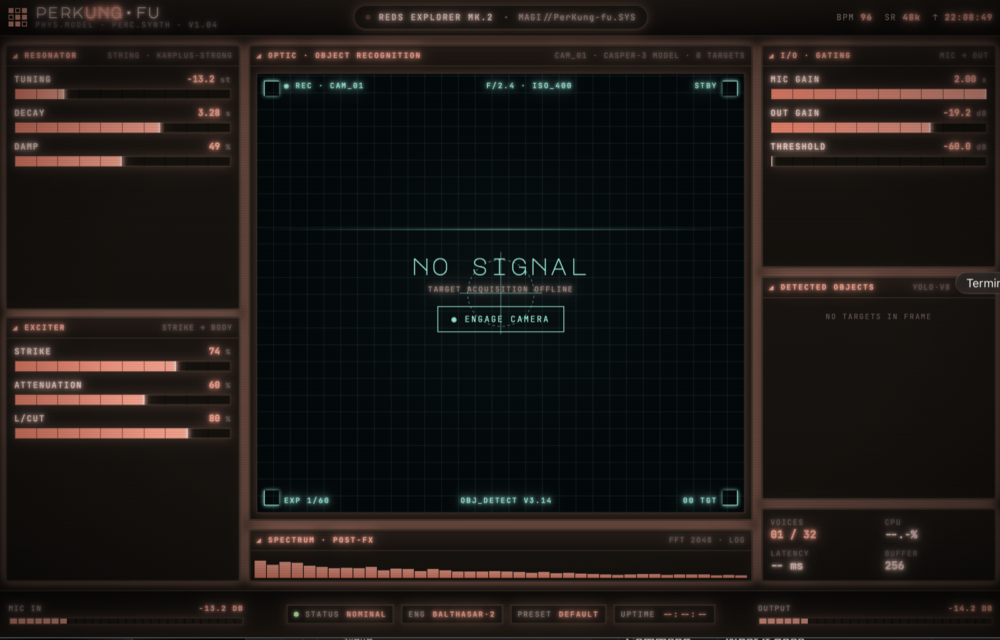

# PerKung-fu

[](https://github.com/IAndy-10/PerKung-fu/actions/workflows/validate.yml)

A modal synthesis percussion plug-in. Hit any surface with a contact mic and PerKung-fu turns each hit into a synthesized drum: onset detection triggers 8 resonant modes of a circular membrane. A camera running object detection switches presets when you hold up an object.

**Formats:** VST3 · AU · Standalone · **Stack:** C++17 / JUCE 8 DSP, Svelte 5 WebView UI · **Validated** with pluginval at strictness level 5



## Demo

[](https://www.youtube.com/watch?v=HDvQbkjqt-I)

---

## Download

**Latest Release:** [PerKung-fu v0.1.0](https://github.com/IAndy-10/PerKung-fu/releases/latest)

### Quick Install (macOS)

1. **Download** the `.zip` from [Releases](https://github.com/IAndy-10/PerKung-fu/releases)
2. **Unzip** and copy the plugins:
   - `PerKung-fu.vst3` → `~/Library/Audio/Plug-Ins/VST3/`
   - `PerKung-fu.component` → `~/Library/Audio/Plug-Ins/Components/`
   - `PerKung-fu.app` → `/Applications/` (optional, for standalone)
3. **Rescan** plugins in your DAW (restart DAW if needed)

### Supported Formats
- **VST3** (macOS 11+)
- **AU** (macOS 10.13+)
- **Standalone** (macOS 11+)

Release builds are signed and notarized by the [release workflow](.github/workflows/build-release.yml) when a `v*` tag is pushed.

---

## Getting Started

### First Use (DAW)

1. Load **PerKung-fu** as an insert on any track, or open the Standalone app.
2. Open the plugin window — the embedded UI loads automatically.
3. Connect a contact mic or use any microphone input through your audio interface.

### Setting Up the Contact Mic

1. Plug your contact mic into your audio interface.
2. Route that input channel into the plugin (in DAW: set the track input accordingly; in Standalone: select your interface as the input device).
3. Adjust **Mic Gain** and **Threshold** so that hits trigger the synthesis without false triggers from ambient noise.
   - Start with **Threshold** around −30 dB and raise it until room noise no longer triggers the synth.
   - Tap the surface and confirm the FFT meter responds.

### Enabling Object Detection (Camera Presets)

1. Click the **Camera** button in the UI.
2. macOS will prompt for **camera permission** — click Allow. (This happens only once per app.)
3. The "Detected Objects" panel shows what the camera sees and the confidence score.
4. Hold a supported object in frame for ~0.6 s — the preset loads automatically and all parameters update.

The plugin works without a camera — presets just won't switch automatically.

### Recommended starting point

- **Threshold**: −30 to −20 dB (adjust to your mic sensitivity)
- **Decay**: 0.5–1.5 s for punchy hits
- **Damp**: 40–60% for a balanced tone
- **Strike**: 60–80% for a natural percussive attack

---

## How it works

### Signal flow

```
Contact mic (stereo in)
  │
  ├─ [Mic Gain]        0–2× input gain (smoothed)
  ├─ [OnsetDetector]   first-difference high-pass → 3 ms peak window
  │                    → threshold (dB) → 50 ms refractory cooldown
  │                    → velocity 0–1 on each detected hit
  ├─ [DrumVoice]       8-mode modal synthesis of a circular membrane
  │                    1 ms crossfade when a hit retriggers a ringing voice
  ├─ [Attenuation]     0–95 % amplitude reduction (smoothed)
  ├─ [L/Cut]           one-pole low-pass, 20 Hz–20 kHz (smoothed)
  └─ [Out Gain]        −36 to 0 dB (smoothed) → mono synth on both channels

Camera → MediaPipe object detection (WebUI) → preset → parameters
```

The synthesis replaces the input signal: there is no dry/wet mix.

### Modal synthesis

Each hit excites 8 sinusoidal modes whose frequencies follow the zeros of the Bessel functions for an ideal circular membrane (ratios 1.000, 1.593, 2.135, 2.295, 2.653, 2.917, 3.156, 3.500 × the fundamental). This follows Gärder, *Physical Modeling of Percussion Instruments* (Chalmers, 2005).

- **Decay** sets T60. Each mode decays per sample by `λ = (1/1000)^(1 / (Fs · T60))`, so the time in seconds is the same at any sample rate.
- **Damp** makes higher modes decay faster: `λ_mode = λ^(1 + damp · ratio)`.
- **Strike** sets how much energy reaches the upper modes: a hard strike excites them, a soft one leaves mostly the fundamental.
- Modes above 0.49 × the sample rate are skipped to avoid aliasing.

### Real-time safety

The audio thread follows the standard real-time rules:

- **No allocation, locks or I/O in `processBlock`.** The input is read and the output written in place, sample by sample, so no scratch buffer is needed.
- **Parameters** are read through `getRawParameterValue()` atomics. Parameters applied every sample (Mic Gain, Attenuation, L/Cut, Out Gain) go through `juce::SmoothedValue` with a 20 ms ramp. Tuning, Decay, Damp and Strike are only read when a hit triggers.
- **Meters and spectrum** are handed to the UI through atomics. The audio thread copies each 1024-sample frame into a handoff buffer guarded by an atomic flag. The FFT (Hann window, 40 log-spaced bins) runs on the message thread in the editor's 30 Hz timer, so it costs nothing when the editor is closed.
- **`ScopedNoDenormals`** at the top of `processBlock`. The low-pass coefficient is recomputed only when L/Cut changes.

---

## Parameters

| Parameter | Range | What it does to the sound |
|-----------|-------|-------------|
| Tuning | −24 .. +24 st | Pitch of the drum (fundamental, relative to C4) |
| Decay | 0.05 .. 4.0 s | How long each hit rings (T60) |
| Damp | 0 .. 100 % | How much faster the high overtones die out than the fundamental |
| Strike | 0 .. 100 % | Hardness of the hit: soft and round to bright and metallic |
| Attenuation | 0 .. 100 % | Lowers the synth level, up to −95 % |
| L/Cut | 0 .. 100 % (20 Hz – 20 kHz) | Low-pass on the output: lower values sound darker and more muffled |
| Mic Gain | 0 .. 2× | Input gain before onset detection |
| Out Gain | −36 .. 0 dB | Output level |
| Threshold | −60 .. 0 dB | How hard a hit must be to trigger a sound |

---

## Camera presets

When the camera detects a supported object and it remains stable for 10 consecutive frames (~0.66 s), the corresponding preset is loaded automatically. The "Detected Objects" panel shows the active target and confidence score.

| Object | Tuning | Character |
|--------|--------|-----------|
| Banana | +10 st | Long warm pluck — slow decay, low damping |
| Apple  | −15 st | Short hard knock — fast decay, bright, percussive |

To add a new preset, edit `WebUI/src/presets.ts` and add the object label to the `ALLOWED` set in `WebUI/src/components/ObjectDetector.svelte`.

---

## Architecture

```
Source/                  C++ / JUCE
  PluginProcessor.{h,cpp}  processBlock, onset detection, parameter smoothing,
                           spectrum handoff + FFT (message thread)
  PluginEditor.{h,cpp}     WebView host, 30 Hz timer, JS↔C++ bridge
  WebviewBridge.h          Intercepts juce:// URLs, calls APVTS
  DSP/DrumVoice.h          8-mode modal synthesis voice
  ParameterIDs.h           Parameter IDs

WebUI/src/               TypeScript / Svelte 5
  App.svelte             Main UI, stabilization logic, preset trigger
  bridge/bridge.ts       JS→C++ parameter queue (one message at a time)
  state/store.ts         Normalized 0–1 parameter stores
  presets.ts             Preset definitions
  components/
    ObjectDetector.svelte  MediaPipe inference loop (15 fps)
    Camera.svelte          getUserMedia stream
    ParamSlider.svelte     Individual parameter control
```

The Svelte UI is built to a single `index.html`, embedded in the binary with `juce_add_binary_data` and loaded in a `WebBrowserComponent` (WKWebView). The plug-in needs no web server or network at runtime.

### JS ↔ C++ communication

- **C++ → JS**: `evaluateJavascript("window.setParameterValue(id, value)")` from a 30 Hz timer on the message thread, along with meter levels and the spectrum. Only changed parameters are sent.
- **JS → C++**: `window.location.href = "juce://setparameter?name=id&value=v"`, intercepted by `WebViewBridge::pageAboutToLoad()` on the message thread. Messages are queued and sent one at a time (16 ms apart) so WKWebView does not drop them.
- The audio thread never touches the bridge.

---

## Building

### Requirements

- macOS (Apple Silicon or Intel)
- Xcode Command Line Tools
- CMake 3.22+
- Node.js + npm

### Steps

```bash
# 1. Install WebUI dependencies (first time only)
cd WebUI && npm install && cd ..

# 2. Configure (JUCE 8 is fetched by CMake)
cmake -B build -DCMAKE_BUILD_TYPE=Release

# 3. Build
cmake --build build -j$(sysctl -n hw.logicalcpu)
```

`npm run build` is run automatically by CMake whenever a WebUI source file changes — no manual step needed.

The plugin is copied to `~/Library/Audio/Plug-Ins/` after each successful build (`COPY_PLUGIN_AFTER_BUILD TRUE`). Artefacts are in `build/PerKungFu_artefacts/Release/`.

---

## Validation

Every push and pull request is built and validated with [pluginval](https://github.com/Tracktion/pluginval) at strictness level 5 by the [Build & Validate workflow](.github/workflows/validate.yml). To run the same check locally:

```bash
/Applications/pluginval.app/Contents/MacOS/pluginval \
  --strictness-level 5 \
  --validate build/PerKungFu_artefacts/Release/VST3/PerKung-fu.vst3
```

It loads the plug-in, processes audio at several sample rates and buffer sizes, automates parameters, saves and restores state, and opens and closes the editor while audio is running. That last test caught a use-after-free in the editor's delayed camera setup, since fixed.

pluginval cannot hear the output. After DSP changes, also test by ear with a contact mic: hits trigger reliably, no clicks when moving knobs, meters and spectrum respond.

---

## Inspirations

The UI aesthetic is directly inspired by *Neon Genesis Evangelion* — the system terminals and interfaces. Visual references were gathered from Pinterest and iterated through Claude's artifact canvas. The CRT bloom, scanlines, and glow were explicit design decisions to land on a sci-fi old-school terminal feel.

---

## LLM use

Claude Sonnet 4.6 (Claude.ai and Claude Code) was used throughout development to speed up the process and to adapt patterns from other functional projects into this codebase. LLM-assisted work includes: C++ DSP architecture and JUCE integration, the JS↔C++ bridge design, CMake configuration, and debugging the WebView parameter pipeline.

A later real-time safety pass was done with Claude Code (Claude Opus 5.5): removing a per-block heap allocation, adding parameter smoothing, moving the FFT off the audio thread, and fixing an editor use-after-free. Each fix was built and validated with pluginval at strictness level 5.

The UI was designed separately. Visual references were gathered from Pinterest and iterated through Claude's artifact canvas until the aesthetics felt right. The CRT bloom and scanline effects were an explicit design decision and the blur/glow layers were set from the beginning.
